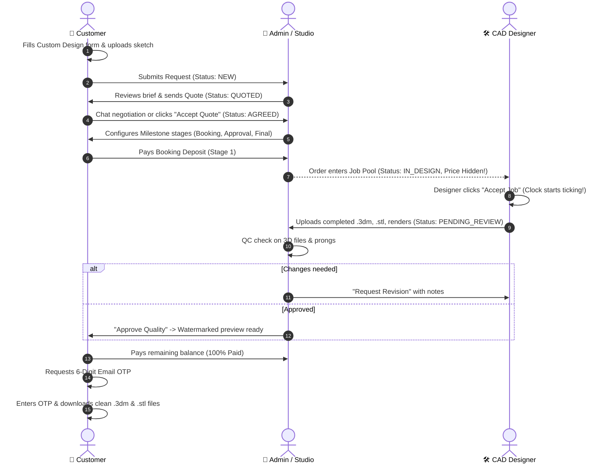
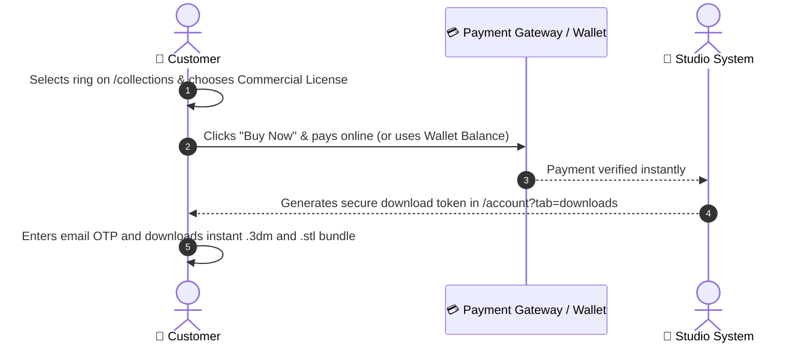

# 💎 Shiuli CAD Studio — Complete System & Workflow Documentation

Welcome to the official, easy-to-understand system documentation for **Shiuli CAD Studio**.

This document is organized into **3 distinct, dedicated sections**:
1. **[Customer (Client) Portal](#part-1--customer-client-portal)**
2. **[Staff (CAD Designer) Portal](#part-2--staff-cad-designer-portal)**
3. **[Super Admin (Studio Manager) Portal](#part-3--super-admin-studio-manager-portal)**
4. **[End-to-End Master Flows (Step-by-Step Journeys)](#part-4--end-to-end-master-flows-step-by-step)**

---

# Part 1 — Customer (Client) Portal

The Customer Portal is designed for jewellery retailers, wholesalers, and private clients who want to purchase ready-made jewellery CAD models or commission bespoke CAD models.

---

## 1. Public Storefront Pages

### 🛍️ Collections & Catalog Page (`/collections`)
* **What it does:** Displays all ready-to-cast jewellery CAD designs (Rings, Necklaces, Earrings, Bangles, Pendants, Mangalsutras, etc.).
* **Key Features:**
  * Filter by category, metal karat, gemstone count, and price.
  * Search bar with instant autocomplete.
  * **Quick View Modal:** Preview design images, dimensions, and specifications without leaving the page.
* **If You Do This ➔ Then That Happens:**
  * **Click "Add to Cart":** Opens the sliding Cart Drawer with your chosen license tier (Standard or Commercial).
  * **Click "Heart" Icon:** Adds the product to your personal Wishlist in your dashboard.
  * **Click Product Card:** Takes you to the full **Product Detail Page** (`/product/:id`).

---

### 🔍 Product Detail Page (`/product/:id`)
* **What it does:** Full technical breakdown of a specific jewellery design.
* **Key Features:**
  * **Interactive 360° Turntable Simulator:** Rotate and inspect the jewellery piece from any angle.
  * **Technical Specs Table:** Diamond count, gemstone carat weight, metal weight estimation (14K, 18K, Platinum), and ring size dimensions.
  * **License Tier Selection:**
    * *Standard License:* For single boutique casting production.
    * *Commercial License:* For mass commercial manufacturing rights.
* **If You Do This ➔ Then That Happens:**
  * **Select License & Click "Buy Now":** Immediately opens the secure checkout / payment modal.
  * **Click "Request Modification":** Redirects to the File Editing Page pre-filled with this product ID so you can request prong, weight, or size alterations.

---

### 🎨 Custom Design Wizard (`/custom-design`)
* **What it does:** Allows clients to submit a brand new, custom jewellery design idea from scratch.
* **Key Features:**
  * Upload reference photos, hand sketches, or CAD screenshots.
  * Select metal type & purity (14K, 18K, 22K Gold, 950 Platinum, 925 Silver).
  * Diamond/Stone specifications (Center diamond shape, prong setting style, side stones).
  * Delivery timeline preference: **Standard (48–72 hours)** or **Express (24 hours)**.
  * Target budget input.
* **If You Do This ➔ Then That Happens:**
  * **Click "Submit Custom Request":** 
    1. A new request ticket (`CR-XXXX`) is created instantly in the database.
    2. The request status is set to `new`.
    3. An email notification is sent to the Studio Admin.
    4. You are automatically navigated to your **Client Dashboard (`/account?tab=custom`)** to track progress and chat with the studio.

---

### 🛠️ File Editing & Repair Page (`/file-editing`)
* **What it does:** For clients who already possess a `.3dm` (Rhino) or `.stl` file and need adjustments.
* **Services available:**
  * Change ring size.
  * Hollow / reduce metal weight for casting economy.
  * Change stone prongs / setting type.
  * Fix mesh errors / naked edges for 3D printing.
  * Convert file format (Rhino `.3dm` ⟷ 3D Print `.stl`).
* **If You Do This ➔ Then That Happens:**
  * **Upload File & Submit Form:** Creates a File Edit Ticket (`FE-XXXX`). You can track, negotiate price, and receive the fixed file in your Client Dashboard.

---

## 2. Client Dashboard (`/account` or `/dashboard`)

The Client Dashboard has **6 main tabs**:

### Tab 1: Custom Requests & File Modifications (`tab=custom`)
* **What it does:** Your real-time command center for all bespoke CAD orders.
* **How it works:**
  * **Status Banner:** Shows live status (`New` ➔ `Quoted` ➔ `Negotiating` ➔ `Agreed` ➔ `In Design` ➔ `Preview Ready` ➔ `Completed`).
  * **Interactive Negotiation:** If Admin quotes a price, you can click **"Accept Quote"** or type a counter-offer in the real-time chat with a message.
  * **Milestone Payments:** If the order is divided into stages (e.g. 10% Booking Deposit, 30% Design Approval, 60% Final Release), you can pay each stage sequentially.
  * **Watermark Previews:** When the designer finishes the CAD model, you can view 3D renders with watermarks.
  * **Revision Request Button:** If any detail does not match your vision, click **"Request Revision"** and submit instructions.
* **If You Do This ➔ Then That Happens:**
  * **Click "Accept Quote":** The price is locked in the contract, and the Booking Payment stage becomes unlocked for payment.
  * **Pay Booking Deposit (Stage 1):** The order immediately changes status to `in_design` and is released into the **Staff Job Pool** for designers to start work.
  * **Click "Approve CAD Design":** Tells the studio you love the 3D model. Unlocks the final payment balance.

---

### Tab 2: Orders (`tab=orders`)
* **What it does:** Lists all completed and past catalog purchases.
* **Features:** Download official VAT/GST invoices, view payment receipts, and check transaction dates.

---

### Tab 3: Secure CAD Downloads (`tab=downloads`)
* **What it does:** The protected vault where you download your final production CAD files.
* **How it works (Two-Factor Secure Delivery):**
  1. Once 100% of the order payment is completed and Admin approves release, the download card shows **"Request Download OTP"**.
  2. Clicking the button generates a temporary 6-digit OTP code sent directly to your registered email address.
  3. Enter the 6-digit OTP code in the verification modal.
  4. The system validates the OTP and issues a **single-use secure download token**.
  5. Your browser immediately downloads the clean `.3dm` (Rhino/MatrixGold) model, watertight `.stl` 3D print file, and 4K high-res renders.
* **If You Do This ➔ Then That Happens:**
  * **Incorrect OTP entered 3 times:** The OTP expires for security to protect against piracy. You can click "Resend OTP" to generate a fresh code.

---

### Tab 4: Wallet & Credits (`tab=wallet_credits`)
* **What it does:** A prepaid wallet system for frequent jewellery clients.
* **Features:**
  * Top up your balance with packages (e.g., Pay ₹25,000, get ₹27,500 CAD credits + 10% bonus).
  * 1-Click checkout for fast purchases without re-entering bank cards each time.
  * Complete ledger showing deposits, bonuses, and spent credits.

---

### Tab 5: Wishlist (`tab=wishlist`)
* **What it does:** Displays all jewellery pieces you bookmarked while browsing.
* **Actions:** Move to cart with 1 click, or remove items.

---

### Tab 6: Profile & Security (`tab=profile`)
* **What it does:** Manage your company name, GST/Tax identification number, phone number, billing address, and change account password.

---

# Part 2 — Staff (CAD Designer) Portal

The Staff Portal (`/staff-portal`) is a dedicated environment for CAD modellers, 3D sculptors, and render specialists.

> [!IMPORTANT]
> **Strict Privacy Rule for Staff:**
> Designers **NEVER** see client contact details, client email, or the monetary price paid by the client. Designers only see technical CAD requirements, gemstone matrices, and deadlines.

---

## 1. Workbench (`tab=workbench`)
* **What it does:** The designer's daily launchpad.
* **Metrics displayed:**
  * Active Jobs currently on your desk.
  * Current Capacity Load (e.g., **2 / 3 jobs taken**).
  * Total earnings cleared and pending.
  * Overall quality rating (out of 5.0 stars).

---

## 2. Available Job Pool (`tab=pool`)
* **What it does:** The marketplace where unassigned, paid client orders wait to be claimed.
* **What staff can see:**
  * Jewellery Category (e.g., "Diamond Halo Engagement Ring").
  * Ring size and metal target.
  * Diamond layout (stone sizes in mm, carats, prong style).
  * Client reference sketches and inspiration images.
  * Time limit to complete (e.g., 48 hours).
* **If You Do This ➔ Then That Happens:**
  * **Click "Accept Job":**
    1. The job is immediately assigned to you.
    2. The job disappears from the public pool so other designers cannot take it.
    3. The delivery countdown clock (`due_at`) starts ticking.
    4. Your capacity count increases (e.g., 1 of 3 slots filled).
    5. You are redirected to your **Active Job Workspace**.
  * **If you have already reached your max job limit (e.g. 3 of 3):** The system disables the "Accept" button and displays *"Capacity Reached — Please deliver current jobs first"*.

---

## 3. Active Job Workspace (`tab=workspace`)
* **What it does:** The actual workbench where the designer works on the design.
* **Sections:**
  * **Design Brief & Specs:** Read precise gemstone measurements, prong tolerances, and finger sizes.
  * **Inspiration Assets:** Click to zoom and inspect client reference photos.
  * **File Upload Area:**
    * Upload primary model: Rhino `.3dm` (MatrixGold/Rhino).
    * Upload 3D print file: `.stl` (watertight mesh).
    * Upload Renders: `.jpg` / `.png` / Turntable video.
  * **Technical Designer Notes:** Add notes for Studio Head (e.g., *"Prong thickness set to 0.85mm for casting safety"*).
* **If You Do This ➔ Then That Happens:**
  * **Click "Submit for Quality Review":**
    1. The files are securely saved to the server.
    2. Order status updates to `pending_review`.
    3. The job leaves your active queue and goes to the **Admin Design Approvals** queue for quality checks.

---

## 4. My Catalog Designs (`tab=my-designs`)
* **What it does:** For freelance/staff designers who create their own original catalogue designs to sell in the Shiuli store.
* **Features:**
  * Upload new jewellery designs with photos and STL files.
  * Once Admin approves, it goes live in the public store.
  * Track sales and earn monthly royalties for every sale.

---

## 5. Job History (`tab=history`)
* **What it does:** Archive of all your completed orders, client ratings received, and exact turnaround hours.

---

## 6. Earnings & Payouts (`tab=earnings`)
* **What it does:** Financial transparency for the designer.
* **Shows:**
  * Cleared earnings available for payout.
  * Pending earnings for jobs currently undergoing client approval.
  * Per-job breakdown showing how much was credited for each CAD file.
  * Payout request button to trigger bank transfer to the designer.

---

## 7. Designer Profile & Settings (`tab=profile`)
* **What it does:** Configure software specializations (e.g., *MatrixGold 3, Rhino 8, ZBrush, KeyShot*), stone setting expertise (Micro-pave, Channel, Bezel), and view max concurrent job permissions.

---

# Part 3 — Super Admin (Studio Manager) Portal

The Admin Portal (`/admin`) is the complete control center for the studio head. Only users with role `admin` or `superuser` have access.

---

## 1. Studio Overview (`activeModule=overview`)
* **What it does:** High-level dashboard summary.
* **Key Widgets:** Total gross sales, active orders count, pending design reviews, unverified payments, and quick navigation shortcuts.

---

## 2. Categories & Products (`activeModule=catalog`)
* **What it does:** Complete e-commerce catalog management.
* **How it works:**
  * **Add / Edit Categories:** Create categories (Rings, Necklaces, etc.) with custom banners and slugs.
  * **Add New Product:**
    * Upload master 3D model (`.3dm`, `.stl`).
    * Upload high-res studio renders & 360° turntable image frames.
    * Specify gold weight (14K, 18K), diamond weights, and dimensions.
    * Set Standard and Commercial prices in INR and USD.
  * **Toggle Visibility:** Hide out-of-season designs or publish newly finished atelier pieces.

---

## 3. Custom Requests Management (`activeModule=custom-requests`)
* **What it does:** Review and manage all bespoke design inquiries submitted by customers.
* **How it works:**
  1. **New Request Review:** Inspect client sketches and specifications.
  2. **Quote Price:** Type the quote price (e.g. ₹5,000) and estimated delivery hours (e.g. 48 hours), then click **Send Quote**.
  3. **Live Negotiation Chat:** If the client counters, discuss terms in the built-in messenger.
  4. **Accept & Lock Price:** Click **"Accept Quote"** once agreed upon.
  5. **Configure Payment Plan:**
     * Admin can choose **100% upfront** or **Multi-Stage Milestone Plan** (e.g. 10% Booking Deposit, 30% Design Approval, 60% Final Release).
* **If You Do This ➔ Then That Happens:**
  * **Click "Lock & Create Order":** Converts the custom request into a formal **Master Order** awaiting initial payment.

---

## 4. File Modifications (`activeModule=file-edits`)
* **What it does:** Specifically handles requests where customers sent their own CAD files for adjustments (resizing, stone changes, hollowing).
* **Features:** Review uploaded file, quote modification cost, and assign to a file repair specialist.

---

## 5. Design Approvals & QC (`activeModule=approvals`)
* **What it does:** The Quality Control department before any file reaches the client.
* **Two sub-sections:**
  1. **CAD File Quality Review:**
     * Shows all CAD deliverables submitted by staff designers.
     * Admin inspects the `.3dm` model, `.stl` mesh integrity, prong height, and renders.
     * **Option A: "Approve Quality":** Status becomes `preview_ready`. Watermarked previews are sent to the client.
     * **Option B: "Request Revision":** Admin writes feedback (e.g. *"Increase center prong thickness to 0.9mm"*). The job is returned to the designer's workbench with revision notes.
  2. **Designer Applications:** Review freelance CAD designers who submitted portfolios to join the Shiuli team. Admin can approve or reject them with 1 click.

---

## 6. Master Orders (`activeModule=orders`)
* **What it does:** Comprehensive log of every order in the studio (Catalog sales, Custom orders, File modifications).
* **Features:**
  * Filter by status: `Awaiting Payment`, `In Design`, `With Designer`, `Pending Review`, `Preview Ready`, `Completed`.
  * **Manual Assignment Override:** Admin can assign any order directly to a specific designer instead of placing it in the pool.
  * **Toggle Download Permission:** Admin can manually enable or revoke client CAD file downloads.

---

## 7. Staff & Job Limits (`activeModule=staff`)
* **What it does:** Manage human resources and designer workload balance.
* **Features:**
  * View current active workload of every designer (e.g. Harshil: 2 active jobs).
  * Adjust **Max Concurrent Job Limit** (e.g. increase from 3 to 5 jobs for top-performing designers).
  * Activate / Deactivate staff accounts.
  * View designer performance ratings and on-time delivery percentages.

---

## 8. Payments & Gateway Logs (`activeModule=payments`)
* **What it does:** Financial verification and audit trail.
* **How it works:**
  * **Online Payments:** Logs real-time webhooks from Razorpay, Cashfree, and Stripe.
  * **Manual Bank Wire Transfers:** When a client pays via direct NEFT/RTGS bank transfer and uploads a payment screenshot/UTR number:
    * The transfer shows up under **"Pending Verification"**.
    * Admin clicks **"Verify & Approve Payment"**.
    * The system marks the order as paid, moves it to the next stage, and issues a receipt to the client.

---

## 9. Credits & Wallets (`activeModule=credits`)
* **What it does:** Manage client prepaid wallet accounts.
* **Features:**
  * View all client wallet balances.
  * Manually credit or debit client accounts (e.g. goodwill bonus or refund).
  * Configure credit top-up tier incentives (e.g. 5% extra on ₹10,000, 10% extra on ₹50,000).

---

## 10. Client Base (`activeModule=clients`)
* **What it does:** CRM directory of all registered clients.
* **Features:** View total orders, lifetime expenditure, contact phone, business name, and quick-call/email actions.

---

## 11. Custom Design Options (`activeModule=custom-options`)
* **What it does:** Configure the form fields that customers see on the Custom Design page.
* **Features:** Add or edit available metals (e.g. 14K Yellow, 18K Rose, Platinum 950), ring size charts, gemstone varieties, and setting types.

---

## 12. Contact Inquiries (`activeModule=contact-inquiries`)
* **What it does:** Displays all messages submitted via the public Contact Us form.
* **Features:** Mark as read, reply directly via email, or archive.

---

## 13. Studio Settings (`activeModule=settings`)
* **What it does:** System-wide settings.
* **Features:**
  * Official Studio Bank Account details (Account name, Number, IFSC, UPI ID, QR code) shown to clients during wire transfer checkout.
  * Studio business address, support phone, and email.
  * USD to INR currency conversion exchange rate.

---

# Part 4 — End-to-End Master Flows (Step-by-Step)

Here are the exact, step-by-step lifecycles of how actions flow between Customer, Admin, and Staff:

---

## 🔄 Flow A: Bespoke Custom CAD Order (The Complete 8-Step Lifecycle)



### Detailed Steps:
1. **Customer Submits:** Customer visits `/custom-design`, uploads sketch, picks 18K Gold, and clicks Submit.
2. **Admin Quotes:** Admin opens `/admin` ➔ **Custom Requests**, reviews the sketch, enters ₹4,500, and sends the quote.
3. **Customer Accepts:** Customer opens `/account?tab=custom`, sees the quote, and clicks **"Accept Quote"**.
4. **Order Configured & Paid:** Admin sets a 10% Booking deposit. Customer pays ₹450 online via Razorpay or Wallet.
5. **Job Pool Release:** The order moves to the **Staff Job Pool** (`/staff-portal` ➔ Pool). *Client price and identity are hidden.*
6. **Designer Claims:** A designer clicks **"Accept Job"**. The 48-hour delivery countdown starts.
7. **Designer Submits CAD:** Designer models the piece in MatrixGold, uploads `ring.3dm` and `ring.stl`, and clicks **"Submit for Review"**.
8. **Admin QC & Customer Delivery:** Admin inspects the files and clicks **"Approve"**. Customer pays the remaining 90% balance, verifies email OTP, and downloads the original files.

---

## 🛒 Flow B: Ready-Made Catalog Purchase (Instant 3-Step Flow)



---

## ⚙️ Flow C: File Modification / Repair Request

1. **Client** uploads a broken or incorrectly sized `.stl` file on `/file-editing`.
2. **Admin** inspects the file on `/admin` ➔ **File Modifications**, quotes a repair fee (e.g. ₹800), and assigns it to a specialist.
3. **Client** accepts the quote and pays via the Client Dashboard.
4. **Staff / Specialist** corrects the mesh/size, uploads the repaired file.
5. **Admin** checks watertight status and marks ready.
6. **Client** downloads the fixed production-ready file.


---


# 💎 Shiuli CAD Studio — Complete System & Workflow Guide

I have created a comprehensive, easy-to-understand documentation guide tailored specifically for your project. To avoid any confusion, the entire architecture is strictly divided into three distinct roles: **Customer (Client)**, **Staff (CAD Designer)**, and **Admin (Studio Manager)**, followed by the exact step-by-step workflows.

📄 **Full Document Location:**
You can read and keep the full formatted manual here: [shiuli_cad_complete_system_documentation.md](file:///C:/Users/Harshil%20Shah/.gemini/antigravity-ide/brain/b9fd5612-690e-4f2d-b57c-b1a6fc6b09d4/shiuli_cad_complete_system_documentation.md)

---

### Quick Role-by-Role Summary

```
                      ┌────────────────────────────────────────┐
                      │          SHIULI CAD ECOSYSTEM          │
                      └───────────────────┬────────────────────┘
                                          │
         ┌────────────────────────────────┼────────────────────────────────┐
         ▼                                ▼                                ▼
   👤 CUSTOMER                      🛠️ STAFF DESIGNER               👑 ADMIN MANAGER
 • Browse /collections            • Job Pool (/staff-portal)       • QC Approvals (/admin)
 • Submit Bespoke CAD             • Accept & Model in Rhino/MG     • Custom Quotes & Negotiation
 • Real-time Price Negotiation    • Upload .3dm & .stl             • Staff Capacity & Job Limits
 • 2-Factor OTP CAD Downloads     • Strictly No Client Contact/Fee • Bank Receipt & Gateway Verif.
```

---

## 1. 👤 Customer (Client)

### Which Pages & What Works:
1. **[Collections Page](file:///c:/Users/Harshil%20Shah/Desktop/TA-Project/shiuli-cad/src/pages/CollectionsPage.tsx) (`/collections`)**
   * **What is working:** Filter jewellery designs by category, gold karat, gemstone count, and price. Includes a **Quick View Modal** and direct cart addition with license tiers (*Standard* vs *Commercial*).
   * **If we do this ➔ That happens:** Clicking **"Add to Cart"** slides open the [CartDrawer](file:///c:/Users/Harshil%20Shah/Desktop/TA-Project/shiuli-cad/src/components/CartDrawer.tsx). Clicking the **Heart icon** adds it to your wishlist.
2. **[Product Detail Page](file:///c:/Users/Harshil%20Shah/Desktop/TA-Project/shiuli-cad/src/pages/ProductDetailPage.tsx) (`/product/:id`)**
   * **What is working:** High-resolution renders, an interactive **360° Turntable Simulator**, diamond table, metal weight estimates (14K/18K/Pt), and license selection.
   * **If we do this ➔ That happens:** Clicking **"Buy Now"** opens the checkout gateway. Clicking **"Request Modification"** opens the File Editing page pre-loaded with this model.
3. **[Custom Design Wizard](file:///c:/Users/Harshil%20Shah/Desktop/TA-Project/shiuli-cad/src/pages/CustomDesignPage.tsx) (`/custom-design`)**
   * **What is working:** Submit a new jewellery concept from scratch. Upload reference images, pick metal purity, target budget, and delivery turnaround (Standard 72h vs Express 24h).
   * **If we do this ➔ That happens:** Submitting creates ticket `CR-XXXX` with status `new`. You are redirected to your Dashboard to chat with the studio.
4. **[File Editing Page](file:///c:/Users/Harshil%20Shah/Desktop/TA-Project/shiuli-cad/src/pages/FileEditingPage.tsx) (`/file-editing`)**
   * **What is working:** Upload existing `.3dm` or `.stl` files to adjust ring size, prong settings, hollow out weight, or fix 3D print mesh errors.
5. **[Client Dashboard](file:///c:/Users/Harshil%20Shah/Desktop/TA-Project/shiuli-cad/src/pages/ClientDashboardPage.tsx) (`/account` or `/dashboard`)**
   * **Tab 1 (`custom`):** Live 2-way chat with Admin to negotiate quotes, accept prices, pay milestone deposits (e.g. 10% booking), view watermarked CAD renders, or request design revisions.
   * **Tab 2 (`orders`):** Master invoices and catalog order history.
   * **Tab 3 (`downloads`):** Secure delivery vault. Click **"Request Download OTP"** ➔ check email for 6-digit code ➔ enter code ➔ download clean `.3dm`, `.stl`, and render packages.
   * **Tab 4 (`wallet_credits`):** Add funds to prepaid wallet, claim deposit bonus credits, and use 1-click checkout.

---

## 2. 🛠️ Staff (CAD Designer)

### Which Pages & What Works:
* **All Staff activities occur on the [Staff Portal](file:///c:/Users/Harshil%20Shah/Desktop/TA-Project/shiuli-cad/src/pages/StaffPortalPage.tsx) (`/staff-portal`):**
  * **Workbench (`tab=workbench`):** Overview of active jobs, workload quota (e.g. 2 of 3 allowed slots used), total earnings, and quality ratings.
  * **Job Pool (`tab=pool`):** Unclaimed client orders ready for modeling.
    > [!IMPORTANT]
    > **Strict Privacy Rule:** Client name, email, and the financial amount paid are **completely stripped/hidden** from designers. Designers only see technical CAD specs, ring sizes, stone matrices, and reference sketches.
    * **If we do this ➔ That happens:** Staff clicks **"Accept Job"** ➔ the job leaves the pool, consumes 1 capacity slot, and starts the delivery countdown clock (`due_at`).
  * **Active Workspace (`tab=workspace`):** Technical brief, download client sketches, upload completed MatrixGold `.3dm`, 3D print `.stl`, and render preview images.
    * **If we do this ➔ That happens:** Staff clicks **"Submit for Quality Review"** ➔ status becomes `pending_review` and moves to Admin QC.
  * **My Designs (`tab=my-designs`):** Designers upload their own jewellery designs for the Shiuli store and earn monthly sales royalties.
  * **Earnings (`tab=earnings`):** Track cleared earnings vs pending approvals, per-job payout history, and request balance settlement.

---

## 3. 👑 Super Admin (Studio Manager)

### Which Pages & What Works:
* **All Studio management occurs on the [Super Admin Portal](file:///c:/Users/Harshil%20Shah/Desktop/TA-Project/shiuli-cad/src/pages/SuperAdminPage.tsx) (`/admin`):**
  * **Overview (`overview`):** Studio gross revenue, active order pipeline, and quick actions.
  * **Categories & Products (`catalog`):** Create categories, add new jewellery products, upload 3D models, set 360 turntable frames, and define Standard / Commercial rates.
  * **Custom Requests (`custom-requests`):** Review incoming client sketches. Enter quote price and estimated deadline. Engage in real-time chat. Once price is agreed upon, configure milestone payment stages (e.g. 10% Booking, 30% Design Approval, 60% Final Release).
  * **Design Approvals / QC (`approvals`):**
    * Inspect CAD files uploaded by staff.
    * Click **"Approve Quality"** ➔ Status becomes `preview_ready`, watermarked preview renders are sent to the client.
    * Click **"Request Revision"** ➔ Enter feedback notes; job returns to designer with revision notice.
    * Review freelance designer job applications.
  * **Master Orders (`orders`):** Global order database. Admin can manually assign any order to a specific designer or toggle download access.
  * **Staff & Job Limits (`staff`):** View staff workload distribution, increase or decrease concurrent job limits (e.g., 3 to 5 concurrent jobs), and activate/deactivate accounts.
  * **Payments & Gateway (`payments`):** Real-time gateway logs (Razorpay/Cashfree/Stripe) and manual bank transfer verification (inspect uploaded wire slip UTR ➔ click **"Verify & Credit Order"**).
  * **Studio Settings (`settings`):** Manage official Studio bank account details, support contact details, and USD/INR exchange rates.

---

## 4. 🔄 End-to-End Flow Example: Bespoke Custom CAD Order

```
[Customer] Fills form on /custom-design
      │
      ▼
[Admin] Reviews sketch on /admin ➔ sends Quote (e.g. ₹5,000)
      │
      ▼
[Customer] Chats / clicks "Accept Quote" on /account?tab=custom
      │
      ▼
[Customer] Pays 10% Booking Deposit (₹500)
      │
      ▼
[System] Strips client price & pushes job to Staff Pool (/staff-portal)
      │
      ▼
[Staff Designer] Clicks "Accept Job" ➔ Countdown timer starts
      │
      ▼
[Staff Designer] Uploads ring.3dm & ring.stl ➔ Clicks "Submit for Review"
      │
      ▼
[Admin] Inspects files in Approvals tab ➔ Clicks "Approve Quality"
      │
      ▼
[Customer] Previews watermarked 3D renders ➔ Pays remaining 90% balance
      │
      ▼
[Customer] Requests 6-digit email OTP ➔ Verifies OTP ➔ Downloads clean .3dm & .stl CAD package!
```

---
